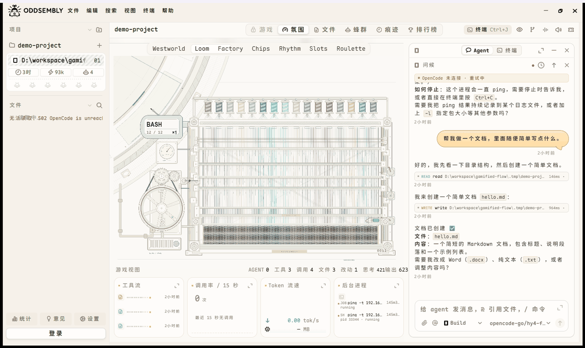
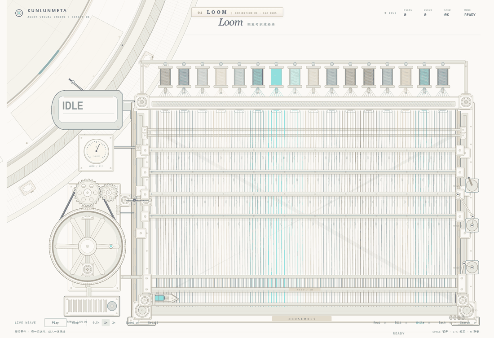
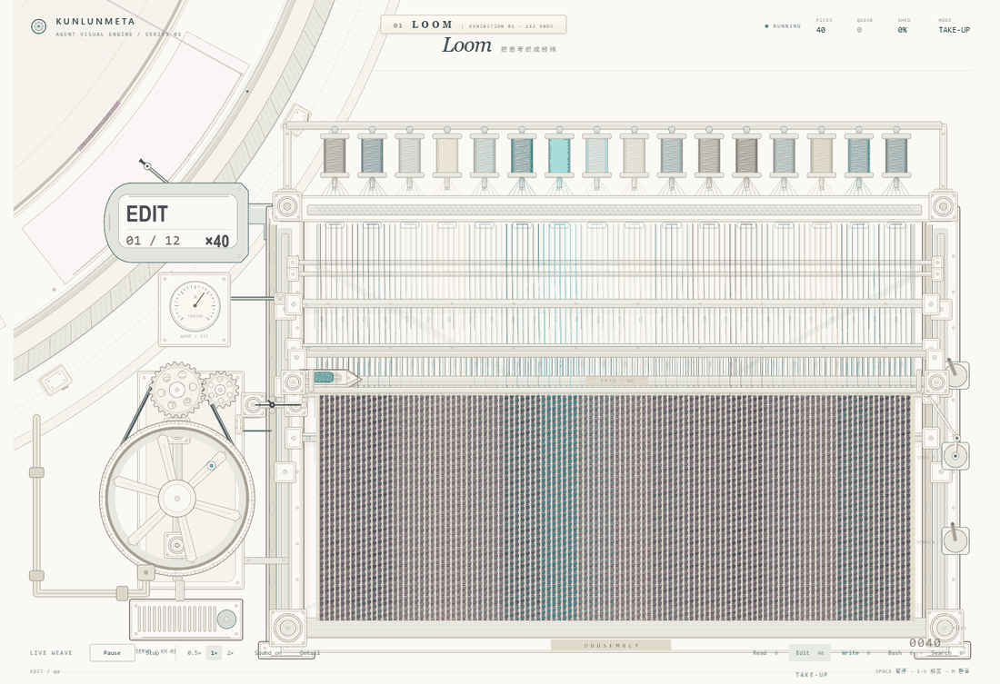
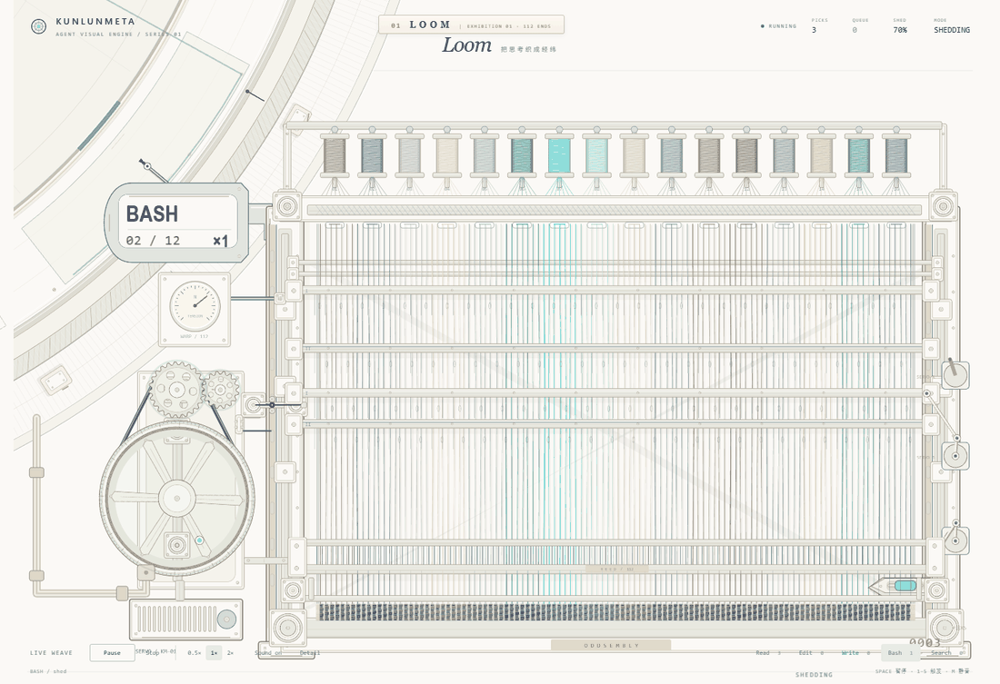
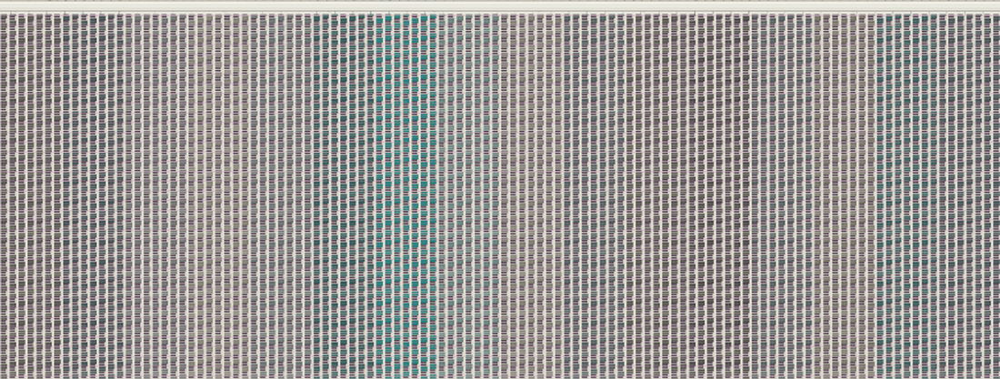
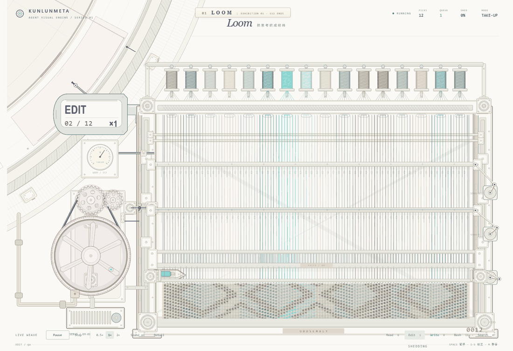

# KunlunMeta Agent Visual Engine — Loom

把 AI Agent 的每一次工具调用，变成织机上一道真实的纬线。



画面**全部由代码程序化绘制**（Canvas 2D 材质 + PixiJS v8 合成），没有一张位图素材：112 根经线、16 组纱色、
四片综框、曲柄滑块伺服、12 槽事件转盘、以及会从零长到满匹的布面，都是算出来的。

---

## 它解决的问题

Agent 干活时，终端只剩滚动的日志：你既看不出它在做什么，也看不出它有多忙。Loom 把工具调用流
翻译成一台**可读的机械**——

| Agent 侧 | 织机侧 |
|---|---|
| 一次工具调用 | 一次投梭 = 一次打纬 = 织入一道纬线 |
| 工具类型（Read / Edit / Write / Bash / Search） | 这一道纬线的颜色、转盘上的槽位与读数 |
| 调用节奏、并发爆发 | 投梭速度、队列深度、饱和时的合并计数 |
| 会话累计 | 布面长度（55 行满匹后换新布） |

它是一台**真织**的织机，不是一个在长高的贴图：布面每一格由当次开口（draft）决定，改开口计划布面就会变
（见 [织法](#织法是真的draft)）。

---

## 长什么样

一台空织机：经线从横梁一直通到卷取梁，梭子和筘停在最底部，布面还没有开始。



织到第 40 针：布边向上生长，筘、梭、梭道跟着织口一起上行，综框被布逐渐埋住。



`SHEDDING` 相位：四片综框按 draft 抬起其中两片，经线开口，等梭子穿过。



布面放大：每 2 px 一根纬线，压/浮由 draft 决定，斜纹是 45° 的对角而不是贴图。



每次调用还有一道光沿导管从转盘跑到齿轮组，抵达时齿轮短促辉光（不改转速）。



---

## 一次调用发生了什么

```
ToolEvent ──▶ 队列（最多 3）──▶ 一次织造循环 ──▶ 计一针 ──▶ 布面 +1 行
                                   │
      SHEDDING ──▶ PICKING ──▶ CLOSING ──▶ BEATING ──▶ TAKE-UP
       提综开口      投梭飞纬      综框下落     打纬压紧     卷取一行
```

- 基础周期 **1.65 s**；队列越深越快（有下限），既不会卡成慢动作，也不会快到看不清打纬。
- 队列满时新调用**合并**进当前这一梭：不丢事件，只少一次机械动作（转盘照常计 `×N`）。
- 12 槽事件转盘：同一工具的连续调用**不推格**，读数窗显示 `BASH ×12`；换工具才前进 30°。

---

## 织法是真的：draft


参考机（CrommaCode）的织机事件是一次调用走 `Shuttle → Needles/Lift → Dock → BeatUp → Lower → TakeUp/Stitch`，
其中 `Needles/Lift` 是**选一组经线抬起**；布面由"织入的针"生成，提花机只做几何/相位计算、不含随机数。

本实现把这条链子落成一份可测的开口计划：

```ts
// atelier/draft.ts —— 直穿、2/2 斜纹
DRAFT = { shafts: 4, rows: [[0,1],[1,2],[2,3],[3,0]] }
shaftOf(end)             // 这根经线穿在第几片综框
warpOver(end, weftLine)  // 这一格是不是经线压在上面
```

- **同一份 draft 同时驱动综框和布面**：抬起的经线压纬，其余纬压经；
- 每 2 px 一根纬线推进一次开口，所以斜纹是真正的 45° 对角；
- 改 draft（例如 `[[0,2],[1,3]]` 或两片 plain weave），布面纹样随之改变。

`scripts/test-draft.mjs` 断言的正是"不是贴图"这件事——每针恰好抬起指定的两片、每行恰好 50% 在上、
相邻两针错开一根、换 draft 布面必然不同。

已知简化：真提花是逐针选针，这里用四片综框分成 4 组近似（四片织机能表达的最大自由度）。

---

## 配色与材质

参考机实测：97% 的像素落在 `#F6F0EA`–`#FCFCF6`，最深的结构线只到 `#746C64`/`#8C8478`。所以这台机器是
**浅底 + 发丝线**：机架 `#E1DACA`、结构线 `#7A6F62`、钢面 `#CFC8B6`、转盘弧 `#C9C2B0`。

唯一的彩色来自工具（`Read #789ED0 · Bash #77BA89 · Edit #C686C0 · Write #D5A868 · Search #5AB2C6`），
织物则把它压成 34% 的淡染——布面始终是浅色织物，调用只留下淡色条带。

---

## 与外壳合并

`shell/` 是 CrommaCode 客户端外壳的复刻；中央 Game View 里挂载的就是这份引擎（`@loom` 别名指向 `../src`），
不是复制品。

- 事件来自外壳自己的 `snapshot.toolCalls`，按 OpenCode 的 call id 去重，没有第二条事件管线；
- 打开外壳时**不重放历史**，只织打开之后新到达的调用；
- 画布下边界停在「游戏视图」标题行，不会压到 HUD 与卡片；
- 卸载即销毁引擎，不泄漏画布或 WebGL 上下文。

---

## 快速开始

### 一条命令起全部（不含 OpenCode）

```powershell
npm install
npm run dev:all
```

起来之后：

| 地址 | 是什么 |
|---|---|
| http://127.0.0.1:5180 | **产品外壳**（完整界面，从这里开始） |
| http://127.0.0.1:5173 | **引擎验收台**（无 HUD 干扰地看场景，截图/ parity 脚本的靶子） |
| http://127.0.0.1:8788/api/health | 桥接健康检查 |

`Ctrl+C` 一次，三个进程一起退出（含 Vite 派生的 esbuild）。只想起产品和桥接：

```powershell
npm run dev:all:no-lab
```

OpenCode **不在**这条命令里。它没在跑时，外壳显示「未连接」是预期状态，不是故障 ——
桥接照常监听，页面照常可用，只是没有实时 Agent 数据。要接真实 Agent 见下一节。

### 分开起（调试单个进程时用）

```powershell
# 只起引擎验收台
npm run dev                      # http://127.0.0.1:5173
npm test                         # 机制 / 转盘 / draft / 实时链路
npm run build                    # dist/

# 只起外壳（另一个终端）
cd shell
npm run dev                      # http://127.0.0.1:5180
npm run bridge                   # http://127.0.0.1:8788
```

> 为什么是两个 Vite：`src/` 是引擎本身加一个验收台，`shell/` 是产品外壳且通过
> `@loom` 别名直接引用 `../src`（同一份引擎，不复制）。两者路由与端口独立，
> `scripts/dev.mjs` 只是把它们和桥接一起拉起来并统一收尾。

### 真实 Agent 驱动（本机 OpenCode 需在运行）

```powershell
opencode service start           # 19474
npm run dev:all                  # 桥接会自动读取 service.json 里的端口与密码

# 或者用独立页 + WebSocket 链路（旧路径，仍可用）
npm run bridge:opencode          # ws://127.0.0.1:8787
node scripts/serve.mjs 4178       # 然后打开 ?mode=loom&live=ws://127.0.0.1:8787
```

脚本化的 mock 演示（不消耗模型调用）：

```powershell
node scripts/mock-demo.mjs --url=http://127.0.0.1:8790 --interval=700 --loop
# 桥用 --allow-inject 启动，页面加 &mock=1 会把状态标成 MOCK 而不是 LIVE
```

---

## 仓库结构

| 路径 | 内容 |
|---|---|
| `src/` `index.html` `public/` | Loom 引擎 + 引擎验收台（无 HUD 的独立页） |
| `shell/` | 产品外壳（React + CSS）；中央 Game View 通过 `@loom` 别名挂载同一份引擎 |
| `scripts/` | 桥接、构建、单测、验收、采集脚本；`dev.mjs` 是一条命令启动器 |
| `docs/` | 视觉规范、事件转盘、联调、回滚 |
| `review/` | 评审文档（只保留 `.md`；截图录像等产物由脚本再生，不入库） |

`node_modules/`、`dist/`、`shots/`、`review/` 下的二进制、`.tmp*`、日志都不入库。

---

## 测试与验收

| 命令 | 覆盖 |
|---|---|
| `npm test` | 机械相位与队列（`test-mechanism`）、转盘 12 槽与 ×N（`test-dial`）、开口计划与布面（`test-draft`）、实时链路去重/重连/缺口（`test-live-link`） |
| `npm run accept:live` | 端到端：真实 OpenCode 调用 → 桥 → 页面，逐条核对账本 |
| `npm run shot` / `record:dial` | 截图与确定性录像（产物落 `shots/`、`review/`） |

`tsc --noEmit` 在根目录与 `shell/` 均无错误；两个应用都可 `build`。

---

## 文档

- [视觉规范（Precision Flat Mechanical）](docs/PRECISION_FLAT_MECHANICAL.md)
- [布料生长 / 浅色配色 / 转盘光路](docs/LOOM_VISUAL.md)
- [事件转盘](docs/EVENT_DIAL.md)
- [布局](docs/LAYOUT.md)
- [真实 OpenCode 联调](docs/OPENCODE_LIVE.md)
- [回滚说明](docs/ROLLBACK.md)
- 外壳侧：[合并指南](shell/docs/MERGE-GUIDE.md)、[工作台契约](shell/docs/OPENCODE-WORKBENCH-CONTRACT.md)

---

## 已知限制

- 平面机构艺术，不做动力学、碰撞或制造校核；连杆只保证几何杆长与位置解算。
- 真实 Agent 桥为本地开发工具（loopback、无鉴权），不是生产级事件服务。
- WebAudio 需要用户手势才能启动；headless 自动化需加 `--autoplay-policy=no-user-gesture-required`。
- 纯聊天（无工具调用）不会织布——织机只对工具动作反应。
- 跨机器像素确定性未证明（同机同浏览器已在回放中验证）。
- 四片综框是提花的近似；逐针选针需替换 draft 的数据结构。
